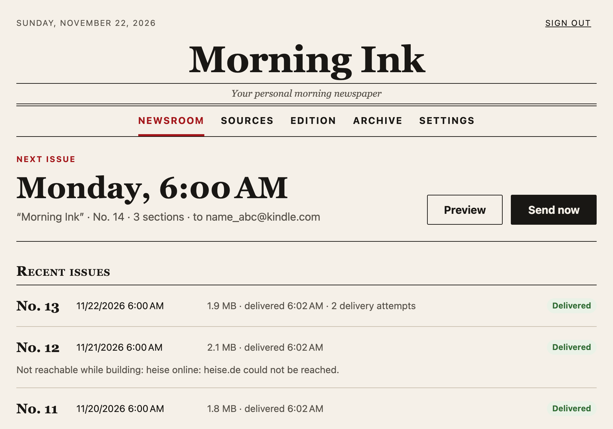

<p align="center">
  
</p>

<h1 align="center">Morning Ink</h1>

<p align="center">
  <strong>Your personal morning newspaper, delivered to your e-reader.</strong><br>
  A self-hosted service that turns your feeds and local news into a daily EPUB newspaper and sends it to your Kindle.<br>
  One Docker container, a web UI, optional AI.
</p>

<p align="center">
  <a href="https://github.com/maxcarl/morning-ink/actions/workflows/ci.yml"></a>
  <a href="https://dotnet.microsoft.com/download/dotnet/10.0"></a>
  <a href="https://github.com/maxcarl/morning-ink/pkgs/container/morning-ink"></a>
</p>

<p align="center">
  
</p>

> [!NOTE]
> Morning Ink is young: expect rough edges and [tell us about them](https://github.com/maxcarl/morning-ink/issues).

## Features

**Your newspaper**

- **RSS and Atom feeds** with full text, cleaned up for e-ink
- **Your FreshRSS:** its categories as sources, unread articles only, marked read once the issue is out
- **Read later with Karakeep:** what you bookmark comes in the next issue and is archived once it is out
- **Newsletters from your mailbox** over IMAP, read only: nothing there is marked, moved or deleted
- **Hacker News and Reddit** from a minimum score, with the linked articles in full
- **OPML import and export** to move feeds from or to another reader
- **Local news and weather** for your town, with the articles themselves, not just headlines
- **"On this day"** from Wikipedia as a small closing section with anniversaries and, if you like, the article of the day, switched off until you want it
- **EPUB with cover, contents and sections**, the same story from several sources merged into one
- **Several editions:** morning, evening, weekend, each with its own sections, time and weekdays

**Your control**

- **Filters per source:** words to require or exclude, a regular expression for titles, a minimum length, no live tickers, no marked ads
- **Archive** to search, download, send again and keep issues, with what the filters left out and why, one click from the filter
- **Status page** with your running and planned issues; a hanging issue can be cancelled. Everyone downloads their setup as JSON (sources, editions, no secrets) to keep in Git or import elsewhere. Admins see all users' jobs, the space each part takes with a warning when it runs low, set the cleanup time, clear the image cache, and download or restore a database backup
- **Feedback from the Kindle:** "More of this" and "Less of this" under every article move that source up or down in its section
- **Optional AI overview**, "the most important in 5 minutes", placed and switched like any section
- **Optional AI for headlines and interests:** lurid headlines rewritten plainly (original kept), interests recognized by topic, not only by keyword, and your "more/less of this" taken as examples
- **Optional AI summaries** with your own Ollama or any OpenAI-compatible provider; private sources can stay local, a daily limit caps requests, and the settings show which article went to which provider. The instructions are editable
- **Setup wizard** with sample sources from several countries; first newspaper in minutes
- **Notifications** by ntfy, Gotify, Telegram or e-mail when an issue is out
- **KOReader and other OPDS readers** fetch issues themselves, with a password of their own

**Your server**

- **One container, no other services:** SQLite and a built-in scheduler
- **Family and friends:** each user with their own sources and editions
- **Local news from your own SearXNG** instead of Bing, if you run one
- **Safe by default:** blocks requests into your home network, encrypts stored passwords, cleans all HTML
- **Installable as an app** on phone and desktop

Later: Miniflux, more readers (Kobo, reMarkable) and AI translation. Morning Ink always works without AI.

Not a goal: replacing your RSS reader, running as a public service, or getting around paywalls.

## Getting started

You need:

- **A computer that is always on and runs [Docker](https://docs.docker.com/get-docker/)**, e.g. a NAS, a Raspberry Pi 4 or 5 (64-bit) or a home server
- **A Kindle** and the Amazon account it is registered to
- **An email account that can send mail (SMTP)**. Your mail provider's help pages list server and port. Gmail, Outlook and iCloud need an *app password* instead of your normal password.

### 1. Start Morning Ink

Create a folder, save this as `compose.yaml` in it:

```yaml
services:
  morning-ink:
    image: ghcr.io/maxcarl/morning-ink:latest
    ports:
      - "8080:8080"
    volumes:
      - morning-ink-data:/data
    restart: unless-stopped

volumes:
  morning-ink-data:
```

Then, in that folder:

```bash
docker compose up -d
docker compose logs morning-ink | grep "setup code"
```

The second command shows a setup code like `ABCD-EFGH-JKLM-NPQR`. It proves that you are the owner of this installation.

### 2. Create your account

Open <http://localhost:8080>, or `http://<address of the computer>:8080` from another device. Enter the setup code and choose a user name and password.

### 3. Follow the wizard

The wizard opens by itself and takes five steps:

1. **Your Kindle:** your Send-to-Kindle address. You find it on Amazon under *Manage Your Content and Devices → Preferences → Personal Document Settings*. It ends in `@kindle.com`.
2. **Mail server:** the SMTP details of your email account. *Save and send a test mail* sends a test issue to your Kindle.
3. **Your region:** a postal code or town for the weather, and local news if you like.
4. **Sources:** pick a few sample feeds. You can add any website later under *Sources*.
5. **First issue:** *Send the first issue*. It arrives on your Kindle within a few minutes, and from then on every day at your delivery time.

> [!IMPORTANT]
> **Allow the sender at Amazon.** Amazon silently drops mail from senders it does not know. In *Personal Document Settings*, add the sender address of step 2 to the *Approved Personal Document E-mail List*. Without this, nothing arrives and there is no error message.

### If nothing arrives

- **The overview page shows each issue with its status.** A failed delivery shows the mail server's error message there.
- **The test mail does not reach the Kindle:** check the approved sender list (see above), then the Send-to-Kindle address.
- **Amazon sends a rejection mail to the sender address,** for example when a file was too large. Look in that mailbox.

### Updates and backups

Update with `docker compose pull && docker compose up -d`. All data lives in the `morning-ink-data` volume. Back up the whole volume: the `keys` folder in it is needed to read stored passwords. The status page also downloads a backup of the database and restores one at the next start; stored passwords in it can only be read with this instance's keys.

Morning Ink is meant for your home network. To reach it from the internet, put it behind a reverse proxy with HTTPS and tell Morning Ink the proxy's address, see [behind a reverse proxy](docs/configuration.md#behind-a-reverse-proxy).

## Configuration

The essentials are set in the web UI. Mail settings can also come from environment variables, e.g. in `compose.yaml`; they then show as read-only in the UI. All settings: [docs/configuration.md](docs/configuration.md).

## Development

Requires the [.NET 10 SDK](https://dotnet.microsoft.com/download/dotnet/10.0).

```bash
dotnet build                          # must build without warnings
dotnet test                           # all tests
dotnet format --verify-no-changes     # formatting check, also run in CI
dotnet run --project src/MorningInk.Web
```

The code follows Clean Architecture (`Domain`, `Application`, `Infrastructure`, `Web`), and architecture tests enforce the layer boundaries. Conventions and design decisions are in [CLAUDE.md](CLAUDE.md).

## Roadmap

What could come next is in [docs/roadmap.md](docs/roadmap.md).

## Contributing

Issues and ideas are welcome. Please open an issue before starting larger changes so we can agree on the approach. Commits follow [Conventional Commits](https://www.conventionalcommits.org/).

## Private use

Morning Ink is for your own reading. Full texts, images and archived issues are for your personal use only: do not share or publish them. Respect the terms of the sites you subscribe to. Paid content only works with your own subscription and login.

## License

Copyright (C) 2026 Maximilian Carl. Morning Ink is free software under the [GNU Affero General Public License v3.0 or later](LICENSE). If you run a modified version as a service for others, you must offer them its source code.

Third-party components and their licenses are listed in [THIRD-PARTY-NOTICES.md](THIRD-PARTY-NOTICES.md).
