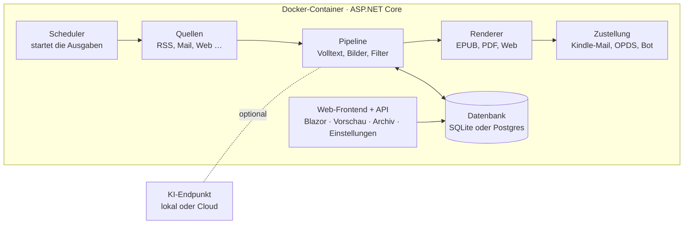

# Morning Ink – Konzept

Stand: 21.11.2026

## Vision

Morning Ink ist ein selbst gehosteter Container und baut jeden Morgen aus frei wählbaren Quellen eine persönliche Zeitung und liefert sie an den Kindle, an andere E-Reader oder ins Web. Vorbild ist KindleEar, aber modern, wartbar und mit optionaler KI.

**Name:** Morning Ink. Repo und Docker-Image heißen `morning-ink`, der .NET-Namespace `MorningInk`. Der Titel der Zeitung bleibt pro Ausgabe frei wählbar. Standard ist „Morning Ink“, möglich ist aber z. B. auch „Die Frühstücksausgabe“.

**Grundprinzipien**

- **Ein Container, keine Pflicht-Abhängigkeiten:** SQLite und ein eingebauter Scheduler reichen. Postgres ist optional.
- **Funktioniert ohne KI:** KI veredelt, ist aber nie Voraussetzung.
- **Alles in der Weboberfläche einstellbar:** Zusätzlich gibt es Export und Import als YAML/JSON für Backups und Git.
- **Privat:** Die Daten bleiben auf dem Server. Eine lokale KI ist möglich.
- **Erweiterbar:** Quellen, Verarbeitungsschritte und Zustellwege sind Plugins mit klaren Schnittstellen.

**Nicht-Ziele**

- Kein Ersatz für einen RSS-Reader: Morning Ink bindet FreshRSS und Miniflux an, statt sie nachzubauen.
- Kein öffentlicher Dienst für Fremde und kein SaaS: gedacht für dich, Familie und Freunde.
- Kein Lesen im Tool selbst: Gelesen wird auf dem E-Reader. Die Web-Ansicht ist Vorschau und Notlösung.
- Keine Paywall-Umgehung: Bezahlinhalte nur mit eigenem Abo und eigenem Login.

## Architektur und Tech-Stack

Alles läuft in einem .NET-Container. Die Arbeit erledigt eine Pipeline aus austauschbaren Bausteinen, die KI hängt optional von außen dran.

Der Scheduler stößt jede Ausgabe an. Quellen, Pipeline-Schritte, Renderer und Zustellwege sind Plugins hinter den Schnittstellen `ISource`, `IProcessor`, `IRenderer` und `IDelivery`.

| Baustein | Vorschlag |
| --- | --- |
| Laufzeit | .NET 10 (LTS), ASP.NET Core, ein Docker-Image für amd64 und arm64 |
| Frontend | Blazor Web App: statisch gerendert, interaktiv nur wo nötig |
| Datenbank | EF Core mit SQLite, optional Postgres |
| Jobs | Quartz.NET oder Hangfire (mit Job-Dashboard) |
| Feeds | System.ServiceModel.Syndication oder CodeHollow.FeedReader |
| Volltext | SmartReader (Readability-Port für .NET) |
| HTML | AngleSharp, HtmlSanitizer |
| Bilder | SkiaSharp oder ImageSharp (Lizenz prüfen) |
| EPUB | Eigener Writer: EPUB ist ein ZIP mit XHTML, das ist überschaubar |
| PDF | QuestPDF (Community-Lizenz prüfen) |
| Mail | MailKit für SMTP und IMAP |
| KI | Microsoft.Extensions.AI |

**Datenmodell (Kern)**

| Objekt | Inhalt | Beziehungen |
| --- | --- | --- |
| Benutzer | Login, Sprache, Rolle | hat Profile |
| Profil (Ausgabe) | Titel, Zeitplan, Empfänger, Land, Region (PLZ oder Ort), Interessen, Layout, Budget, Vorlauf, KI-Optionen | gehört einem Benutzer, hat Rubriken |
| Rubrik | Name, Reihenfolge, Limit | gehört zu einem Profil, enthält Quellen und Themen |
| Quelle | Typ, URL oder Ort und Land (bei Lokales), Regeln, Filter, Abrufintervall, nur lokale KI | kann in mehreren Rubriken stecken, nutzt optional einen Zugang |
| Zugang | Verfahren, verschlüsselte Zugangsdaten, Cookies, Status, Ablauf | gehört einem Benutzer, wird von mehreren Quellen genutzt |
| Thema | Beschreibung, Stichwörter, Mindestrelevanz | für die KI-Recherche |
| Interesse | Thema, Stichwörter, Gewicht | gehört zu einem Profil, beeinflusst die Priorität |
| Artikel | URL, Titel, Volltext, Bilder, Zeit, Hash, KI-Ergebnisse | stammt aus einer Quelle oder einem Thema |
| Heft | Datum, Nummer, Datei, Größe, Status, angeheftet | gehört zu einem Profil, enthält Artikel |
| Zustellung | Weg, Zeitpunkt, Ergebnis, Fehler | gehört zu einem Heft |
| Feedback | Mehr/Weniger, gemerkt | Benutzer × Artikel |

**Tests:** Vergleichstests für die Volltext-Extraktion mit gespeicherten Beispielseiten, epubcheck für jedes gebaute EPUB in der CI, dazu eine Checkliste für einen echten Kindle (Cover, Inhaltsverzeichnis, Bilder, Umlaute, Links).

**Updates:** Datenbank-Migrationen laufen beim Start automatisch, vorher wird ein Backup gezogen. Versionierung nach SemVer, Images mit `latest`, `x.y` und einem `edge`-Kanal für Vorabversionen.

**Ressourcen:** Das Tool soll auch auf einem Raspberry Pi 4 mit 2 GB laufen. Dafür sind parallele Abrufe und Bildverarbeitung begrenzt und einstellbar, und große Ausgaben werden in Etappen statt komplett im Speicher gebaut.

**Clean Code**

Der Code soll lesbar, testbar und leicht erweiterbar sein. Neue Quellen oder Zustellwege kommen dazu, ohne bestehenden Code anzufassen.

| Bereich | Regel |
| --- | --- |
| Schichten | Clean Architecture: `Domain` (Modelle, Regeln, keine Abhängigkeiten), `Application` (Anwendungsfälle, Schnittstellen), `Infrastructure` (Datenbank, HTTP, Mail, KI), `Web` (Blazor, API). Abhängigkeiten zeigen nur nach innen |
| Erweiterungen | Quellen, Pipeline-Schritte, Renderer und Zustellwege hinter `ISource`, `IProcessor`, `IRenderer`, `IDelivery`. Eine neue Quelle = eine neue Klasse plus Registrierung |
| Prinzipien | SOLID, kleine Klassen mit einer Aufgabe, sprechende Namen, keine magischen Strings |
| .NET-Bausteine | Dependency Injection, Options-Pattern für Einstellungen, `IHttpClientFactory`, `TimeProvider` statt `DateTime.Now`, strukturiertes Logging |
| Fehler | Erwartbare Fehler (Quelle offline, Login abgelaufen) als Ergebnis-Typen statt Exceptions. Exceptions nur für echte Ausnahmen |
| Qualität | Nullable aktiviert, Warnungen als Fehler, Roslyn-Analyzer, `.editorconfig`, `dotnet format` in der CI |
| Tests | Unit-Tests für Domain und Application, Integrationstests mit Testcontainers und gespeicherten Beispielseiten, Architekturtests (z. B. NetArchTest) sichern die Schichtgrenzen |
| Entscheidungen | Architektur-Entscheidungen als kurze ADRs im Repo, Conventional Commits, Pull Requests mit grüner CI |

## Quellen

RSS ist nur der Anfang. Jede Quelle liefert am Ende „Artikel“ oder „Kacheln“ (z. B. Wetter), die in die Zeitung einfließen.

| Quelltyp | Beispiele | Idee dahinter |
| --- | --- | --- |
| RSS / Atom / JSON Feed | Tagesschau, heise, Blogs | Basis, mit Feed-Autodiscovery aus einer normalen URL |
| Lokales | Nachrichten und Wetter für die Region des Profils | Aus PLZ oder Ort werden Ort, Landkreis und Koordinaten; daraus entstehen die Rubrik „Lokales“ und die Wetter-Kachel |
| Webseite ohne Feed | Lokalzeitung, Vereinsseite | Scraper mit CSS-Selektoren für Liste, Titel und Link |
| E-Mail-Newsletter | Substack, Fach-Newsletter | Eigenes IMAP-Postfach wird abgeholt, Mails werden zu Artikeln |
| RSS-Reader | FreshRSS, Miniflux | Kategorien übernehmen, nur Ungelesenes, danach als gelesen markieren |
| Read-it-later | Wallabag, Readeck, Karakeep | Gemerkte Artikel landen in der nächsten Ausgabe |
| Community | Hacker News, Reddit, Lobsters | Mit Punkte-Schwelle und optional Top-Kommentaren |
| Social | Mastodon-Listen, Bluesky | Threads oder Links aus einer Liste |
| Video und Audio | YouTube-Kanäle, Podcasts | Transkript bzw. Shownotes, KI fasst zusammen |
| Software | GitHub Releases | Changelog deiner genutzten Tools |
| Tages-Kacheln | Wetter (Open-Meteo), Kalender (CalDAV/ICS), Müllabfuhr, Kurse | Erscheinen kompakt auf der Titelseite |
| Smart Home | Home Assistant | Sensorwerte oder Hinweise, z. B. „Fenster offen“ |
| Manuell | Browser-Extension, Share-Sheet, Telegram-Bot | „Lies ich morgen“: Link schicken, kommt in die Zeitung |
| API / Webhook | Eigene Skripte | Beliebige Inhalte per POST einspeisen |
| Fundstücke | Wikipedia-Artikel des Tages, „Heute vor x Jahren“ | Zeitungsgefühl, kleine Rubrik am Ende |

**Authentifizierung für Quellen**

Manche Quellen brauchen eine Anmeldung. Zugangsdaten werden als eigene, wiederverwendbare „Zugänge“ gespeichert und von beliebig vielen Quellen genutzt, z. B. ein FreshRSS-Login für alle Kategorien.

| Verfahren | Typische Quellen |
| --- | --- |
| HTTP Basic / Digest | Private Feeds, selbst gehostete Dienste |
| API-Key oder Bearer-Token (Header oder Query) | Miniflux, Karakeep, Such-APIs, eigene APIs |
| OAuth 2 | Wallabag, Reddit, Mastodon, Google (Kalender) |
| Reader-APIs | FreshRSS über Google-Reader- oder Fever-API |
| Formular-Login | Zeitungsabo: Login-URL, Felder und Erfolgsprüfung konfigurierbar, Sitzung wird wiederverwendet |
| Cookie-Import | Seiten mit 2FA oder Captcha: Cookies aus dem Browser einfügen, mit Ablaufwarnung |
| IMAP | Newsletter-Postfach, Erkennung von Kindle-Ablehnungen |

**Regeln**

- Zugangsdaten werden nur an die eigene Domain gesendet, auch nach Weiterleitungen. Wechselt die Domain, fallen Header und Cookies weg.
- Jeder Zugang hat einen „Anmeldung testen“-Knopf und einen Status. Schlägt die Anmeldung fehl, gibt es eine Benachrichtigung („Login bei Zeit Online abgelaufen“), statt still leerer Artikel.
- OAuth-Tokens werden automatisch erneuert. Cookie-Gläser sind pro Zugang getrennt.
- Alles liegt verschlüsselt in der Datenbank (siehe Betrieb und Sicherheit) und erscheint weder in Logs noch im Export im Klartext.

## Verarbeitung

Jeder Artikel läuft durch eine Pipeline. Die Schritte lassen sich pro Quelle an- und abschalten.

1. **Abholen:** HTTP mit Caching (ETag, Last-Modified), Retries, eigener User-Agent. Optional Cookies für bezahlte Abos.
2. **Volltext:** Readability-Algorithmus, dazu Regeln pro Website, wenn die automatische Erkennung danebenliegt.
3. **Bereinigen:** HTML säubern, Werbeblöcke, Share-Buttons und Tracking-Parameter in Links entfernen.
4. **Bilder:** Graustufen, verkleinern, optional Dithering für E-Ink. Maximal x Bilder pro Artikel, Bildunterschriften behalten, Icons verwerfen.
5. **Duplikate erkennen:** über normalisierte URLs und ähnliche Titel. Dieselbe Meldung aus mehreren Quellen erscheint nur einmal, mit „auch bei: …“.
6. **Filtern:** Stichwörter ein- oder ausschließen, Regex, Mindestlänge, Sprache, „keine Liveticker“.
7. **Priorisieren:** nach Quelle, Aktualität, Punkten (HN, Reddit), Interessen (siehe unten) oder KI-Relevanz. Limit pro Rubrik und pro Ausgabe.
8. **Übersetzen (optional):** per KI, DeepL oder LibreTranslate.
9. **Lesezeit schätzen:** „4 Min.“ im Inhaltsverzeichnis.

**Interessen**

Allgemeine Themen, die dich besonders interessieren oder gar nicht, z. B. „Homelab“, „Lokalpolitik“, „Raumfahrt“ oder „Fußball“. Sie gelten für alle Quellen eines Profils und verändern, welche Artikel es in die Ausgabe schaffen, wenn das Limit einer Rubrik oder das Lesezeit-Budget nicht für alle reicht.

| Einstellung | Bedeutung |
| --- | --- |
| Thema | Name, z. B. „Homelab“ |
| Stichwörter | Begriffe, an denen das Thema erkannt wird, z. B. „Proxmox, NAS, Raspberry Pi, Selfhosting“. Ganze Wörter; mit Stern am Ende auch Wortanfänge („Fußball*“ findet „Fußballer“) |
| Gewicht | stark bevorzugen, bevorzugen, weniger, ausblenden |

- **Ohne KI:** Treffer der Stichwörter in Titel und Anrisstext heben oder senken die Priorität eines Artikels. „Ausblenden“ wirkt wie ein Filter.
- **Mit KI:** Die KI erkennt das Thema auch ohne die genauen Stichwörter („Proxmox-Update“ zählt zu „Homelab“, „Kane trifft doppelt für die Bayern“ zu „Fußball“) und bewertet die Relevanz. Das Thema wird dafür zur Beschreibung, die das Modell als Daten bekommt. Stichwörter bleiben als Hinweis und als Rückfall, wenn die KI nicht erreichbar ist.
- **Nachvollziehbar:** Artikel, die wegen eines Interesses nach oben gerückt sind, können einen kleinen Vermerk tragen („Homelab“).
- **Lernt mit:** Die Feedback-Links „Mehr davon“ und „Weniger davon“ schlagen Änderungen am Gewicht vor, statt still etwas zu verändern.

## KI-Unterstützung

Die KI hat einen großen Hebel: Sie macht aus einem Stapel Artikel eine redigierte Zeitung. Jede Funktion ist einzeln schaltbar.

| Funktion | Was sie bringt |
| --- | --- |
| Tagesüberblick | Titelseite „Das Wichtigste in 5 Minuten“ über alle Quellen |
| Zusammenfassung pro Artikel | 2–3 Sätze als Kasten über dem Volltext |
| Themen-Cluster | Dieselbe Story aus 4 Quellen wird ein Artikel mit Blickwinkeln |
| Relevanz nach Interessenprofil | „Interessiert mich: .NET, Homelab, Lokalpolitik“ sortiert und filtert |
| Neutrale Überschriften | Clickbait-Titel werden sachlich umformuliert |
| Kategorisieren | Artikel ohne Rubrik landen automatisch in Politik, Tech, Sport … |
| Übersetzen | Englische Quellen auf Deutsch, optional zweisprachig |
| Hintergrund-Kasten | Kurze Erklärung von Begriffen und Vorgeschichte |
| Video und Podcast zusammenfassen | Aus Transkripten werden lesbare Artikel |
| Wochenrückblick | Sonntagsausgabe mit den großen Themen der Woche |

**Themen-Recherche (optional)**

Neben den festen Quellen sucht die KI selbst nach Artikeln zu Themen, die du festlegst, z. B. „Wärmepumpen-Förderung“ oder „neue .NET-Version“. Nur die relevantesten Treffer kommen in die Ausgabe.

1. **Suchanfragen erzeugen:** aus der Themenbeschreibung und den Stichwörtern
2. **Suchen:** über einen Suchdienst, z. B. ein selbst gehostetes SearXNG, eine Such-API wie Brave, Tavily oder Kagi, oder die eingebaute Websuche des KI-Anbieters
3. **Laden und abgleichen:** Volltext extrahieren, Duplikate gegen die festen Quellen und frühere Ausgaben prüfen
4. **Relevanz bewerten:** Punktzahl von 0 bis 100 mit kurzer Begründung, die optional im Artikel steht („Ausgewählt, weil …“)
5. **Einsortieren:** Treffer über der Schwelle landen in der Rubrik des Themas oder in einer eigenen Rubrik „Recherche“

**Einstellungen pro Thema:** Beschreibung in eigenen Worten, Stichwörter, Sprache, Zeitraum, Mindestrelevanz, max. Artikel, erlaubte und gesperrte Domains, Häufigkeit (täglich oder wöchentlich), Kostenlimit.

Auch mit einer lokalen KI braucht die Suche selbst Internetzugang. Die Bewertung kann dagegen komplett lokal laufen.

**Anbindung**

- **OpenAI-kompatible API als Standard:** deckt Ollama, LM Studio, vLLM, OpenRouter und OpenAI ab. Dazu Anthropic und Azure als eigene Provider.
- **In .NET:** Microsoft.Extensions.AI als Abstraktion, dann ist der Provider austauschbar.
- **Modell pro Aufgabe:** ein kleines lokales Modell für Kategorien, ein stärkeres für den Tagesüberblick.
- **Kontrolle:** Tageslimit für Tokens oder Kosten, Cache für Ergebnisse. Die Prompts sind ab Werk fertig abgestimmt und funktionieren sofort, lassen sich aber in der Oberfläche anpassen, pro Profil überschreiben und jederzeit auf den Standard zurücksetzen.
- **Ausfallsicher:** Ist die KI nicht erreichbar, erscheint die Zeitung trotzdem, nur ohne Extras.

**Modell-Empfehlung (Server ohne GPU)**

- **Lokal über Ollama auf der CPU:** kleine, quantisierte Modelle mit 3 bis 8 Milliarden Parametern (z. B. Qwen oder Gemma) für die Massenarbeit: Kategorisieren, Relevanz bewerten, kurze Zusammenfassungen.
- **Cloud:** ein starkes Modell (z. B. Claude) nur für den Tagesüberblick und die Themen-Cluster. Das sind wenige Aufrufe am Tag, die Kosten liegen bei wenigen Cent.
- **Vorlauf:** Weil die CPU langsam ist, startet die Verarbeitung früh, z. B. um 4 Uhr, damit die Zeitung um 6 Uhr fertig ist. Der Vorlauf ist pro Profil einstellbar.

**Datenschutz bei Cloud-KI**

- Jede Quelle hat den Schalter „nur lokale KI“. Ist er an, gehen ihre Inhalte nie an ein Cloud-Modell.
- Für private Quelltypen ist er standardmäßig an: Newsletter-Postfach, Kalender, Home Assistant, Merkliste und alle Quellen mit Zugang.
- Der Tagesüberblick aus der Cloud nutzt nur freigegebene Artikel. Private Inhalte werden lokal zusammengefasst oder bleiben draußen.
- Das Dashboard zeigt, welche Inhalte an welchen Anbieter gingen.

**Prompt-Updates:** Bringt ein Update neue Standard-Prompts und du hast eigene angepasst, wird nichts überschrieben. Die Oberfläche zeigt die Unterschiede, und du entscheidest: übernehmen, zusammenführen oder behalten.

## Ausgabe und Layout

Das Hauptformat ist EPUB. Weitere Formate kommen später dazu, als eigene „Renderer“.

**Formate**

- **EPUB:** für Kindle (via Send to Kindle), Kobo, KOReader
- **PDF im Zeitungslayout:** zweispaltig, für reMarkable, Tablets oder zum Ausdrucken
- **Web-Ansicht:** dieselbe Ausgabe im Browser lesen
- **Audio (später):** per Sprachausgabe als privater Podcast-Feed

**Aufbau einer Ausgabe**

1. Titelseite mit Zeitungsname, Datum, Ausgabennummer, Wetter, Terminen und Top-Schlagzeilen
2. KI-Tagesüberblick (optional)
3. Inhaltsverzeichnis mit Rubriken und Lesezeit
4. Rubriken mit Artikeln: Titel, Quelle, Zeit, Autor, Zusammenfassung, Volltext, Link zum Original
5. Schlussseite mit Fundstücken, Zitat oder Rätsel

**Layout-Optionen:** Vorlagen (klassisch, kompakt, Magazin), Schriftart, Bildgröße, Bilder an oder aus, QR-Code zum Original fürs Handy, Rubrikfarben für Farb-E-Ink.

**Lesezeit-Budget:** Pro Ausgabe stellst du eine Lesezeit ein, z. B. 20 Minuten. Das Tool füllt die Ausgabe nach Priorität bis zum Budget. Wichtige Texte kommen voll rein, weniger wichtige nur als Zusammenfassung, der Rest fällt weg oder rutscht in die nächste Ausgabe.

**Links als Endnoten:** Links im Text werden zu nummerierten Verweisen [1], [2] und am Artikelende gesammelt. Das liest sich auf E-Ink ruhiger.

**Kinderausgabe:** ein eigenes Profil, in dem die KI ausgewählte Nachrichten kindgerecht erklärt. Altersstufe, Themen und Ausschlüsse sind einstellbar, Ausgabe auf einen eigenen Kindle.

## Zustellung und Zeitplan

Die Zeitung geht per Send-to-Kindle-Mail raus. Weitere Wege machen das Tool auch für andere Reader nützlich.

**Zustellwege**

- **Kindle per E-Mail:** über SMTP, mit Prüfung der Größe gegen das 50-MB-Limit
- **OPDS-Katalog:** KOReader und viele Reader-Apps holen sich die Ausgabe selbst
- **Ablage:** WebDAV, Nextcloud oder ein Ordner auf dem Server
- **Messenger:** Telegram- oder Matrix-Bot schickt die Datei
- **Download-Seite:** die letzten Ausgaben zum Herunterladen

**Zeitplan**

- Einfache Auswahl (Uhrzeit, Wochentage) oder Cron-Ausdruck für Profis
- Mehrere Ausgaben pro Profil: Morgen, Abend, Wochenende
- „Nur senden, wenn mindestens x Artikel“, sonst ausfallen lassen
- Jederzeit manuell auslösen, auch per API oder Home-Assistant-Button
- Bei Fehlern Nachricht per ntfy, Gotify oder E-Mail

**Fehlerverhalten**

- Fällt eine Quelle aus, erscheint die Ausgabe trotzdem, mit einem Hinweis wie „heise war heute nicht erreichbar“.
- War der Server zur geplanten Zeit aus, wird die verpasste Ausgabe beim Start nachgeholt, sofern sie nicht älter als einstellbare x Stunden ist.
- Fehlgeschlagene Zustellungen werden mit wachsendem Abstand wiederholt. Eine Ausgabe wird nie doppelt gesendet.
- Zwei Ausgaben laufen nie gleichzeitig für dasselbe Profil.

**Kindle-Eigenheiten**

- Amazon lehnt fehlerhafte EPUBs ab und schickt dann nur eine Fehlermail an den Absender. Deshalb prüft epubcheck in der CI jedes EPUB, das die Tests bauen, darunter eines aus echten Artikelseiten. Im Image läuft epubcheck nicht, weil es Java bräuchte (etwa 150 MB); echte Ablehnungen erkennt die IMAP-Überwachung.
- Optional liest das Tool das Absender-Postfach per IMAP mit, erkennt solche Ablehnungen und zeigt sie im Dashboard.
- Ein eindeutiger Titel pro Ausgabe sorgt dafür, dass der Kindle die Hefte sauber nach Datum sortiert.
- Dateigröße unter dem Mail-Limit von Amazon halten, sonst Bilder automatisch stärker verkleinern.

## Frontend

Die Weboberfläche ist der Redaktionsraum. Entschieden: Blazor Web App mit .NET 10. Alles bleibt in einem Stack und einem Container. Die Seiten werden standardmäßig statisch gerendert und sind dort interaktiv, wo es etwas bringt: Drag & Drop, Live-Suche, Vorschau, Feed-Test, Bestätigungsdialoge. Der Kindle-Browser muss keine Seite der Oberfläche darstellen (siehe ADR 0002).

| Seite | Inhalt |
| --- | --- |
| Dashboard | Nächste Ausgabe, letzte Ausgaben, Fehler, Feed-Gesundheit |
| Quellen | URL einfügen und Feed automatisch finden, Vorschau der letzten Artikel, „Jetzt testen“, OPML-Import |
| Ausgaben (Profile) | Rubriken zusammenstellen, Reihenfolge per Drag & Drop, Zeitplan, Empfänger |
| Vorschau | Die nächste Ausgabe im Browser blättern, so wie sie auf dem Kindle aussieht |
| Archiv | Alle Ausgaben herunterladen, erneut senden, Volltextsuche |
| Merkliste | Manuell hinzugefügte Links für die nächste Ausgabe |
| KI | Provider, Modelle, Prompts, Verbrauch und Kosten |
| Einstellungen | SMTP, Benutzer, Backup, Import und Export |
| Jobs und Logs | Was lief wann, wie lange, mit welchem Ergebnis |

**Anmeldung:** lokale Benutzer, OIDC für Authentik, Authelia oder Keycloak, alternativ Header-Auth hinter einem Reverse Proxy.

**PWA mit Teilen-Ziel:** Das Frontend lässt sich als App auf dem Handy installieren. Über „Teilen → Morning Ink“ landet ein Link direkt auf der Merkliste für die nächste Ausgabe.

**Einrichtungsassistent:** Beim ersten Start führt ein Assistent durch Kindle-Adresse, SMTP-Zugang und eine Testmail. Danach kann man Beispielquellen wählen und sofort eine erste Ausgabe bauen. Ziel: die erste Zeitung in unter 10 Minuten.

**Sprachen:** Die Oberfläche gibt es auf Deutsch und Englisch, weitere Sprachen kommen per Ressourcendatei dazu.

**Gestaltung im Zeitungsstil**

Die Oberfläche soll sich wie eine Redaktion anfühlen, aber bedienbar bleiben wie ein modernes Tool. Der Stil steckt in Typografie, Linien und Sprache, nicht in Effekten.

| Element | Umsetzung |
| --- | --- |
| Kopfzeile | „Morning Ink“ als Zeitungskopf in Serifenschrift, darunter Datum, Ausgabennummer und eine feine Doppellinie |
| Schrift | Überschriften in einer Serifenschrift (z. B. Fraunces oder Source Serif), Formulare und Tabellen in einer klaren serifenlosen Schrift. Alle Schriften selbst gehostet, kein Google-CDN |
| Farben | Papierweiß mit leichtem Cremeton, tiefschwarze „Tinte“, eine sparsame Akzentfarbe in Zeitungsrot. Dunkelmodus als „Nachtausgabe“ |
| Raster | Dashboard im Spaltenlayout: Die nächste Ausgabe ist der „Aufmacher“, daneben Meldungen und Status in schmalen Spalten. Haarlinien als Trenner statt Karten mit Schatten |
| Details | Rubrik-Namen in Kapitälchen, Zeit- und Ortsangaben im Stil einer Dachzeile, Initialen nur auf der Startseite |
| Archiv | Ausgaben als Stapel von Titelseiten-Miniaturen, so wie sie auf dem Reader aussehen |
| Sprache | Redaktionsvokabular, wo es verständlich bleibt: Ressorts, Ausgabe, Redaktionsschluss (Vorlauf), Meldungen. Leere Zustände mit einem Augenzwinkern: „Keine neuen Meldungen – gute Nachrichten.“ |

**Grenzen:** Lesbarkeit geht vor Stil. Formulare bleiben klar, Kontraste erfüllen WCAG AA, und auf dem Handy funktioniert alles einspaltig. Eine Papiertextur höchstens ganz dezent.

**Umsetzung:** eigenes, schlankes CSS mit Design-Tokens (Farben, Schriften, Abstände) statt eines schweren Komponenten-Frameworks, das gegen den Stil arbeiten würde. Die Tokens werden auch für Titelseite und Layout-Vorlagen der Zeitung genutzt, damit Tool und Zeitung wie aus einem Guss wirken.

## Konfiguration

Die Einstellungen haben drei Ebenen: global, pro Ausgabe und pro Quelle. Die untere Ebene überschreibt die obere.

| Ebene | Einstellungen |
| --- | --- |
| Global | Zeitzone, Sprache, SMTP, Standard-Empfänger, Datenverzeichnis, Aufbewahrung (Ausgaben, gesehene Artikel), Benutzer, Benachrichtigungen |
| Ausgabe (Profil) | Name und Titel der Zeitung, Zeitplan, Vorlauf, Empfänger, Region (PLZ oder Ort), Format, Layout-Vorlage, Rubriken mit Reihenfolge, Lesezeit-Budget, Interessen mit Gewicht, max. Artikel gesamt, max. Dateigröße, Mindestanzahl, KI-Funktionen an oder aus |
| Quelle | URL und Typ, Rubrik, max. Artikel, max. Alter, Volltext an oder aus, Website-Regeln, Bilder, Filter, Priorität, Abrufintervall, Zugang, nur lokale KI |
| KI | Provider und Endpunkt, API-Key, Modell pro Aufgabe, Prompts, Tageslimit, Interessenprofil, Recherche-Themen, Suchdienst |
| Layout | Vorlage, Schrift, Bildgröße, Graustufen und Dithering, QR-Codes, Titelseiten-Kacheln |

**Grundsätze:** Geheimnisse können per Umgebungsvariable oder Docker-Secret kommen. Die komplette Konfiguration ist als YAML exportierbar, damit man sie in Git versionieren kann.

**Aufbewahrung und Speicherplatz**

Ein nächtlicher Aufräumjob hält das gemountete Volume klein. Jeder Bereich hat seine eigene Frist.

| Bereich | Regel | Vorschlag Standard |
| --- | --- | --- |
| Ausgaben (EPUB, PDF) | nach Alter, Anzahl oder Gesamtgröße, je nachdem, was zuerst greift | 30 Tage, max. 1 GB |
| Angeheftete Ausgaben | werden nie gelöscht, z. B. eine besondere Wochenendausgabe | – |
| Archiv-Einträge | Titel, Links und Suchindex bleiben länger als die Dateien, „neu bauen“ bleibt möglich | 1 Jahr |
| Bilder- und Volltext-Cache | kurze Frist, wird bei Bedarf neu geladen | 7 Tage |
| Gesehene Artikel (Duplikate) | lang genug, dass nichts doppelt kommt | 30 Tage |
| KI-Ergebnisse | Zusammenfassungen und Bewertungen im Cache | 30 Tage |
| Logs und Job-Historie | für die Fehlersuche | 30 Tage |

Nach dem Aufräumen wird die SQLite-Datenbank komprimiert (VACUUM). Das Dashboard zeigt den Speicherverbrauch pro Bereich und warnt ab einer einstellbaren Schwelle.

## Betrieb und Sicherheit

- **Healthcheck:** Endpunkt `/health` für den Docker-Healthcheck, prüft Datenbank, Scheduler und Speicherplatz. Optional Metriken für Prometheus.
- **Backups:** Sicherung per Klick und zeitgesteuert, bestehend aus Datenbank und Konfiguration als eine Datei. Wiederherstellung über das Frontend.
- **Schutz des Heimnetzes:** Beim Abrufen von URLs sind private Adressen standardmäßig gesperrt (z. B. 192.168.x.x, 10.x.x.x, localhost, Router, NAS). Geprüft wird auch nach Weiterleitungen und DNS-Auflösung. Freigaben für eigene Dienste wie FreshRSS gibt es nur über eine explizite Liste. Sie kommt aus der Konfiguration (`Http__AllowedHosts`) und aus der Oberfläche; dort dürfen nur Admins sie ändern.
- **Verschlüsselte Zugangsdaten:** API-Keys, SMTP- und Login-Passwörter liegen verschlüsselt in der Datenbank (ASP.NET Data Protection). Im Frontend werden sie nie wieder im Klartext angezeigt.

**Injection-Schutz:** Alles von außen gilt als nicht vertrauenswürdig: eingegebene URLs, Feeds, Webseiten, Newsletter-Mails, KI-Antworten und geteilte Links.

| Angriffsfläche | Schutz |
| --- | --- |
| Eingegebene URLs | Nur `http` und `https`. Verboten sind z. B. `file:`, `javascript:` und `data:`. Keine Zugangsdaten in der URL, Längenlimit, Punycode normalisieren, Ports standardmäßig nur 80 und 443 |
| Abruf | Maximale Antwortgröße, Timeouts, höchstens 5 Weiterleitungen, jede davon erneut gegen die Netz-Sperrliste geprüft |
| Feeds, OPML, XML | Externe Entities aus (kein XXE), Limits gegen „XML-Bomben“ |
| HTML aus Artikeln | Strikte Allowlist-Bereinigung vor EPUB und Web-Ansicht. Kein Script, keine Event-Handler, kein `style` mit URLs |
| Web-Vorschau | Content-Security-Policy, Artikel in einer Sandbox-iframe, getrennt vom Admin-Frontend |
| Bilder | Pixel- und Größenlimit gegen Dekompressions-Bomben, neu kodiert, Dateiname aus Hash |
| Dateinamen und Pfade | Aus Titeln nur bereinigte Namen, kein Path Traversal, alles bleibt unter dem Datenverzeichnis |
| Datenbank | Nur parametrisierte Abfragen über EF Core, kein zusammengesetztes SQL |
| E-Mail | Betreff und Dateinamen ohne Zeilenumbrüche (keine Header-Injection) |
| Prompt Injection | Artikeltext geht klar abgegrenzt als Daten an die KI. Die KI hat keine Werkzeuge mit Nebenwirkungen, ihre Antworten werden gegen ein Schema geprüft und können nie Einstellungen ändern |
| Layout-Vorlagen | Sandboxed Template-Engine (z. B. Scriban oder Fluid) statt Razor, kein Codezugriff |
| Externe Programme | Etwa Calibre: Argumente als Liste, nie über eine Shell |
| Feedback-Links im EPUB | Signierte Tokens (HMAC) mit Ablaufdatum, damit niemand Links fälschen kann; Rate-Limit |
| API und Teilen-Ziel | Nur mit Token oder Login, CSRF-Schutz für Formulare |

**Rechtliches:** Volltexte, Bilder und Archiv sind nur für den privaten Gebrauch gedacht. Ausgaben und Web-Ansicht sind deshalb nie ohne Login erreichbar, und die README weist darauf hin. Die Lizenzen der Bibliotheken (z. B. ImageSharp, QuestPDF) werden vor einer Veröffentlichung geprüft.

## Weitere Ideen

Das sind Ideen, die das Tool von einem Feed-Konverter zu einer echten persönlichen Zeitung machen.

**Feedback vom Kindle zurück**

- Unter jedem Artikel stehen Links wie „Mehr davon“, „Weniger davon“ und „Später lesen“. Sie zeigen auf einen API-Endpunkt deines Servers, der nur eine kurze Bestätigung zurückgibt, keine Seite der Oberfläche. So lernt das Interessenprofil mit.
- Ein Link „In Wallabag speichern“ pro Artikel
- `My Clippings.txt` vom Kindle hochladen: Markierungen landen im Archiv und fließen ins Profil ein

**Inhalt**

- Longread-Ausgabe am Wochenende mit längeren Artikeln aus der Woche
- Rätselseite mit Sudoku oder Kreuzworträtsel
- „Was gestern fehlte“: Artikel, die das Limit gesprengt haben, rutschen in die nächste Ausgabe
- Fortsetzungen: Updates zu einer Story von gestern markieren

**Betrieb**

- Feed-Gesundheit: tote oder leere Feeds melden
- Statistik: Artikel pro Quelle, Größe der Ausgaben, KI-Kosten
- REST-API und Webhooks, Home-Assistant-Integration
- Synchronisieren: Gelesenes in FreshRSS oder Miniflux als gelesen markieren
- Vorlagen-Galerie: fertige Pakete wie „Deutsche Nachrichten“ oder „Tech-Morgen“ zum Importieren

**Experimentell**

- Audio-Ausgabe zum Anhören beim Frühstück
- Chat mit dem Archiv: „Was stand letzte Woche über X?“

## Ausbaustufen und Entscheidungen

Ein kleiner, täglich nutzbarer Kern kommt zuerst, alles andere baut darauf auf.

1. **MVP:** RSS mit Volltext, Lokales mit Wetter für die eigene Region, EPUB, Kindle-Mail, Zeitplan, Quellen und Einstellungen im Frontend, SQLite, ein Container, Healthcheck, Schutz des Heimnetzes, verschlüsselte Zugangsdaten
2. **Komfort:** Vorschau, Archiv, OPML-Import, Filter, Interessen mit Stichwörtern, Duplikate, mehrere Ausgaben, mehrere Benutzer (Familie und Freunde), OPDS und weitere Reader
3. **KI:** Zusammenfassungen, Tagesüberblick, Themen-Cluster, Übersetzung, Interessen per KI erkennen
4. **Mehr Quellen:** Newsletter per IMAP, FreshRSS und Miniflux, Wallabag, YouTube, Kacheln für Kalender
5. **Feedback und mehr:** Mehr/Weniger-Links, Interessenprofil, PDF-Layout, Audio

**Abnahmekriterien für das MVP**

Das MVP ist fertig, wenn:

- [ ] drei echte Feeds sieben Tage am Stück fehlerfrei um 6 Uhr auf dem Kindle landen
- [ ] die Einrichtung vom leeren Container bis zur ersten Zeitung unter 10 Minuten dauert
- [ ] jedes gebaute EPUB epubcheck ohne Fehler besteht
- [ ] eine ausgefallene Quelle die Ausgabe nicht verhindert und in der Zeitung vermerkt ist
- [ ] kein Artikel doppelt erscheint
- [ ] interne Adressen und andere Schemata als http/https als Quell-URL abgelehnt werden
- [ ] ein Neustart des Containers weder Daten noch eine fällige Ausgabe verliert
- [ ] das Image auf amd64 und arm64 läuft
- [ ] die Titelseite das Wetter für die Region zeigt und die Rubrik „Lokales“ Nachrichten aus der Region enthält

**Entschieden**

- **Familie und Freunde:** mehrere Benutzer mit eigenen Profilen und eigenen Readern. Das Datenmodell ist ab dem MVP mehrbenutzerfähig, die Verwaltung im Frontend kommt in Stufe 2.
- **Andere Reader:** neben Kindle auch Kobo, KOReader, PocketBook und reMarkable, über OPDS, Download, WebDAV und PDF.
- **Nicht-Ziele:** bestätigt.
- **KI:** Ollama ohne GPU, siehe Modell-Empfehlung.
- **Frontend:** Blazor, standardmäßig statisch gerendert, interaktiv wo es etwas bringt. Keine Rücksicht auf den Kindle-Browser (ADR 0002).
- **Länder:** Profil und jede lokale Quelle haben ein Land. Postleitzahlen werden nur dort gesucht, Ortsnamen und Nachrichten kommen in der Sprache und Ausgabe dieses Landes (z. B. Deutschland `de`/`DE`, USA `en`/`US`). Ohne Land wird weltweit gesucht.
- **Lokale Nachrichten:** über eine Nachrichtensuche nach Ort und Landkreis hinter einer Schnittstelle. Bing News RSS (der Ortsname geht dabei an Microsoft): Die Links führen direkt zum Verlag, so bekommen lokale Meldungen Volltext oder wenigstens den Anriss (ADR 0003). Google News lieferte nur Überschriften. Später wahlweise ein selbst gehostetes SearXNG, dasselbe wie für die KI-Recherche.

**Offen**

- [ ] Lizenz: AGPL-3.0 (wer es als Dienst anbietet, muss Änderungen offenlegen) oder MIT (maximal frei)?
- [ ] GitHub, Docker Hub und Domain für „morning-ink“ prüfen und reservieren

## MVP-Aufgaben

Das MVP besteht aus 25 Aufgaben in fünf Etappen. Nach Etappe 2 kommt die Zeitung bereits täglich auf den Kindle, mit Quellen aus einer Seed-Konfiguration. Etappe 3 macht sie über die Oberfläche bedienbar.

| # | Etappe | Aufgabe | Fertig, wenn | Braucht | Status |
| --- | --- | --- | --- | --- | --- |
| 1 | 0 Fundament | Solution mit `Domain`, `Application`, `Infrastructure`, `Web` und Testprojekten; Nullable, Analyzer, `.editorconfig`, Warnungen als Fehler | Build ohne Warnungen, Architekturtest prüft die Schichtgrenzen | – | ✅ erledigt |
| 2 | 0 Fundament | CI: Build, Tests, `dotnet format`, Docker-Image für amd64 und arm64 | Pull Request läuft grün, Image liegt in der Registry | 1 | ✅ erledigt |
| 3 | 0 Fundament | Dockerfile und Compose: Non-Root-Benutzer, Volume `/data`, Endpunkt `/health` | `docker compose up` startet, Healthcheck ist grün | 1 | ✅ erledigt |
| 4 | 0 Fundament | EF Core mit SQLite, Kernmodell mehrbenutzerfähig, automatische Migration mit vorherigem Backup | Neustart verliert keine Daten, jede Migration legt ein Backup an | 1 | ✅ erledigt |
| 5 | 0 Fundament | Verschlüsselte Zugangsdaten über Data Protection, Schlüssel in `/data` | Passwörter stehen nicht im Klartext in der Datenbank und sind nach Neustart lesbar | 4 | ✅ erledigt |
| 6 | 1 Inhalte holen | Sicherer HTTP-Client: nur http/https, Sperre für interne Adressen auch nach Weiterleitung und DNS, Größenlimit, Timeouts | Tests mit `127.0.0.1`, `192.168.x.x`, `file:` und Weiterleitung ins Heimnetz werden abgelehnt | 1 | ✅ erledigt |
| 7 | 1 Inhalte holen | RSS/Atom-Quelle hinter `ISource`: ETag-Caching, max. Alter, max. Artikel, XXE aus | Drei echte Feeds liefern Artikel, Tests mit gespeicherten Feeds laufen grün | 6 | ✅ erledigt |
| 8 | 1 Inhalte holen | Volltext und Bereinigung hinter `IProcessor`: SmartReader, HTML-Allowlist, Rückfall auf Feed-Text | Vergleichstests mit mindestens 10 gespeicherten Seiten laufen grün | 7 | ✅ erledigt |
| 9 | 1 Inhalte holen | Bilder: Graustufen, verkleinern, Pixel- und Größenlimit, Dateiname aus Hash | Icons fliegen raus, Ausgabe bleibt unter dem Größenlimit | 8 | ✅ erledigt |
| 10 | 1 Inhalte holen | Duplikate über normalisierte URLs und eine Liste gesehener Artikel | Ein zweiter Lauf direkt danach liefert keine neuen Artikel | 7 | ✅ erledigt |
| 11 | 2 Zeitung | EPUB-Renderer hinter `IRenderer`: Titelseite, Inhaltsverzeichnis, Rubriken, Metadaten | epubcheck meldet 0 Fehler, Kindle-Checkliste ist erfüllt | 8, 9 | 🔄 epubcheck fehlerfrei, Kindle-Checkliste bis auf den Titel erfüllt; der wird mit Aufgabe 12 per Mail geprüft ([Checkliste](kindle-checkliste.md)) |
| 12 | 2 Zeitung | Kindle-Zustellung hinter `IDelivery`: MailKit, Größenprüfung, Betreff ohne Zeilenumbrüche | Testmail und Ausgabe kommen auf dem Kindle an | 5, 11 | 🔄 umgesetzt; Test mit echtem SMTP und Kindle auf später verschoben (`tools/send-test-issue.cs`) |
| 13 | 2 Zeitung | Ausgabe-Job: Quellen, Pipeline, Renderer, Zustellung; Ausfallvermerk, Sperre pro Profil, nie doppelt senden | Simulierter Ausfall einer Quelle: Ausgabe kommt trotzdem, mit Vermerk | 10, 12 | ✅ erledigt |
| 14 | 2 Zeitung | Scheduler mit Quartz.NET: Zeitplan und Zeitzone pro Profil, verpasste Ausgaben nachholen | Container um 6 Uhr aus, um 7 Uhr an: Die Ausgabe kommt nach | 13 | ✅ erledigt |
| 15 | 2 Zeitung | Aufräumjob, Grundversion: alte Ausgaben und gesehene Artikel nach Frist löschen | Ausgaben älter als die Frist sind weg, angeheftete bleiben | 4 | ✅ erledigt |
| 16 | 2 Zeitung | Region im Profil und Wetter-Kachel: PLZ oder Ort über Geocoding zu Ort, Landkreis und Koordinaten, Wetter von Open-Meteo auf der Titelseite | Titelseite zeigt das Wetter für die Region; ist der Wetterdienst nicht erreichbar, kommt die Ausgabe ohne Kachel | 4, 6, 11 | ✅ erledigt |
| 17 | 2 Zeitung | Quelle „Lokales“ hinter `ISource`: Nachrichten zu Ort und Landkreis über eine Nachrichtensuche (`INewsSearch`, anfangs Google News RSS, seit ADR 0003 Bing News RSS). Jede Quelle hat ihren eigenen Ort, so sind mehrere Orte möglich (z. B. zu Hause und bei den Kindern) | Für eine Test-PLZ erscheinen Artikel aus der Region, Tests mit gespeicherten Antworten laufen grün | 7, 16 | ✅ erledigt |
| 18 | 3 Oberfläche | Blazor-Grundgerüst mit Login, Admin wird beim ersten Start angelegt | Ohne Login ist keine Seite und keine Datei erreichbar | 3, 4 | ✅ erledigt |
| 19 | 3 Oberfläche | Seite Quellen: anlegen, Feed aus Website-URL finden, Vorschau, „Jetzt testen“; scheitert der Test an der Netzsperre, bietet sie Admins die Freigabe des Hosts an | Website-URL eingeben, Feed wird gefunden, Vorschau zeigt Artikel | 7, 18 | ✅ erledigt |
| 20 | 3 Oberfläche | Seite Profil: Titel, Zeitplan, Empfänger, Region, Rubriken mit Quellen | Änderungen wirken ab der nächsten Ausgabe | 14, 16, 19 | ✅ erledigt |
| 21 | 3 Oberfläche | Seite Einstellungen: SMTP mit Testmail (Passwort verschlüsselt in der Datenbank); Freigaben fürs Heimnetz (nur Admin). Werte aus Umgebungsvariablen haben Vorrang und erscheinen schreibgeschützt | Testmail kommt an, Passwort wird nie wieder angezeigt | 12, 18 | ✅ erledigt; Testmail per Gmail am 2026-11-22 auf dem echten Kindle angekommen |
| 22 | 3 Oberfläche | Dashboard: nächste Ausgabe, letzte Ausgaben mit Status, „Jetzt senden“ | Fehler einer Ausgabe sind dort ohne Blick ins Log sichtbar | 13, 18 | ✅ erledigt |
| 23 | 3 Oberfläche | Einrichtungsassistent: Kindle-Adresse, SMTP, Region, Testmail, Beispielquellen, erste Ausgabe | Vom leeren Container zur ersten Zeitung in unter 10 Minuten | 19–21 | ✅ erledigt; Durchlauf mit echtem Kindle steht noch aus |
| 24 | 4 Abnahme | README: Installation, Amazon-Freigabe, Hinweis auf privaten Gebrauch | Jemand ohne Vorwissen kommt allein bis zur ersten Zeitung | 23 | 🔄 geschrieben; Test durch jemanden ohne Vorwissen steht aus, das Container-Image muss dafür öffentlich sein |
| 25 | 4 Abnahme | Probelauf über 7 Tage mit drei echten Feeds | Alle Abnahmekriterien für das MVP sind abgehakt | 1–24 | – |

Die Aufgaben 6 bis 10 lassen sich parallel zu 4 und 5 bauen. Am meisten Risiko steckt in 8 (Volltext) und 11 (EPUB für Kindle), deshalb lohnt es sich, dort früh echte Seiten und einen echten Kindle zu testen.

## Aufgaben Stufe 2 (Komfort)

| Nr. | Bereich | Aufgabe | Fertig, wenn | Hängt ab von | Status |
| --- | --- | --- | --- | --- | --- |
| 26 | Ausgaben | Mehrere Ausgaben: mehrere Profile pro Benutzer mit eigenen Rubriken, Zeit und Empfänger; Wochentage pro Profil | Morgen- und Abendausgabe kommen getrennt, eine Wochenendausgabe nur samstags und sonntags | 20, 22 | ✅ erledigt |
| 27 | Quellen | OPML-Import und -Export auf der Quellen-Seite | Ein Export aus FreshRSS oder Feedly wird übernommen, Dubletten werden übersprungen | 19 | – |
| 28 | Ausgaben | Archiv: alle Ausgaben, herunterladen, erneut senden, anheften | Eine alte Ausgabe lässt sich erneut an den Kindle schicken | 22 | ✅ erledigt; Titelseiten-Miniaturen kommen später |
| 29 | Ausgaben | Vorschau: die nächste Ausgabe im Browser blättern (Sandbox-iframe) | Zeigt dieselben Artikel wie die Zustellung, ohne sie als gelesen zu markieren | 22 | ✅ erledigt; KI nur auf Wunsch |
| 30 | Verarbeitung | Filter pro Quelle: Stichwörter ein- oder ausschließen, Mindestlänge, keine Liveticker, keine Werbung | Ausgeschlossene Artikel erscheinen nicht in der Ausgabe; „Testen“ an der Quelle zeigt, was aussortiert wird und warum | 19 | ✅ erledigt; Werbung an den Kennzeichen des Verlags erkannt, Wortanfänge mit Stern; Regex vorerst nicht |
| 31 | Verarbeitung | Duplikate über Quellen hinweg erkennen, mit „auch bei: …“ | Dieselbe Meldung aus zwei Quellen steht nur einmal im Heft | 13 | ✅ erledigt |
| 32 | Verarbeitung | Interessen mit Stichwörtern und Gewicht pro Profil | Bevorzugte Themen rücken bei knappem Limit nach vorn, „ausblenden“ wirkt als Filter | 26 | ✅ erledigt; Erkennung per KI kommt später |
| 33 | Benutzer | Mehrere Benutzer (Familie und Freunde), vom Admin angelegt | Jeder sieht und bearbeitet nur die eigenen Quellen und Ausgaben | 18 | ✅ erledigt; Seite „Benutzer“ (anlegen, Passwort zurücksetzen, löschen mit allen Daten), „Konto“ zum eigenen Passwortwechsel; Rollenwechsel später |
| 34 | Zustellung | OPDS-Katalog für KOReader und Reader-Apps | KOReader holt die Ausgabe mit Login selbst ab | 28 | – |
| 35 | Quellen | SearXNG als Nachrichtensuche für „Lokales“, wählbar neben Bing (`INewsSearch`, Einstellung `NewsSearch__SearxngUrl`) | Mit gesetzter Adresse kommen lokale Meldungen über die eigene SearXNG-Instanz, mit Volltext vom Verlag; ohne bleibt Bing | 17 | – |

## Aufgaben Stufe 3 (KI)

| Nr. | Bereich | Aufgabe | Fertig, wenn | Hängt ab von | Status |
| --- | --- | --- | --- | --- | --- |
| 36 | KI | Grundlage: OpenAI-kompatibler Anbieter (Ollama, LM Studio, OpenRouter, OpenAI) über Microsoft.Extensions.AI; Adresse, Modell und verschlüsselter Schlüssel in den Einstellungen, Verbindungstest; „nur lokale KI“ pro Quelle; Standard-Prompts versioniert im Repo | Ist die KI nicht erreichbar, erscheint die Ausgabe trotzdem, ohne Extras | 21 | ✅ erledigt |
| 37 | KI | Zusammenfassung pro Artikel: 2–3 Sätze als Kasten „Kurz gefasst“ über dem Text | Artikel tragen eine geprüfte Zusammenfassung; der Artikeltext geht nur abgegrenzt als Daten an das Modell | 36 | ✅ erledigt; Test mit dem echten Ollama steht aus |
| 38 | KI | Vorlauf: Verarbeitung startet pro Profil früher, damit ein langsames Modell rechtzeitig fertig wird | Die Ausgabe kommt pünktlich, auch wenn die Zusammenfassungen eine Stunde brauchen | 36 | ✅ erledigt |
| 39 | KI | Tagesüberblick: Seite „Das Wichtigste in 5 Minuten“ | Die Titelseite fasst die wichtigsten Meldungen aller Rubriken zusammen | 36 | – |
| 40 | KI | Neutrale Überschriften | Reißerische Titel werden sachlich umformuliert, das Original bleibt erhalten | 36 | – |
| 41 | KI | Themen-Cluster: dieselbe Story aus mehreren Quellen als ein Artikel mit Blickwinkeln | Baut auf den Duplikaten (31) auf | 31, 36 | – |
| 42 | KI | Übersetzen fremdsprachiger Quellen | Englische Artikel erscheinen auf Deutsch, auf Wunsch zweisprachig | 36 | – |
| 43 | KI | Themen-Recherche | Treffer zu eigenen Themen landen mit Begründung in der Ausgabe | 35, 36 | – |
| 44 | KI | Anzeige, welche Inhalte an welchen Anbieter gingen, und Tageslimit | Das Dashboard zeigt Aufrufe und Inhalte pro Anbieter | 36 | – |
| 45 | KI | Interessen per KI erkennen: Thema als Beschreibung, das Modell ordnet Artikel anhand von Titel und Anriss zu (Ergebnis gegen ein Schema geprüft); Stichwörter bleiben Hinweis und Rückfall; „nur lokale KI“ der Quelle gilt | „Kane trifft doppelt für die Bayern“ fällt unter „Fußball – auslassen“, ohne dass ein Stichwort passt; ohne KI wirken nur die Stichwörter; das Log nennt, welches Interesse gegriffen hat | 32, 36, 38 | – |
